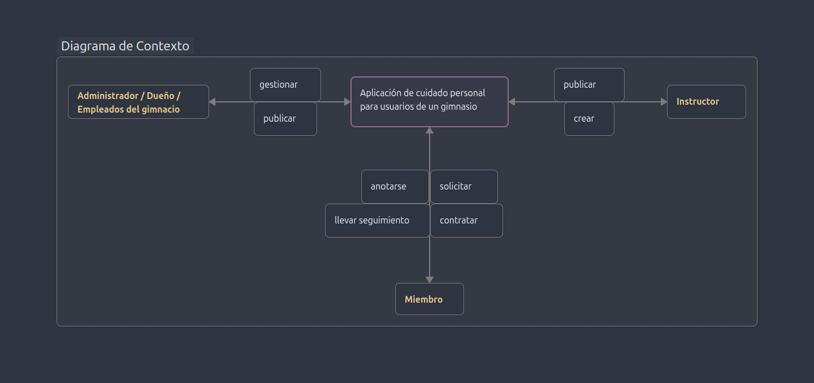
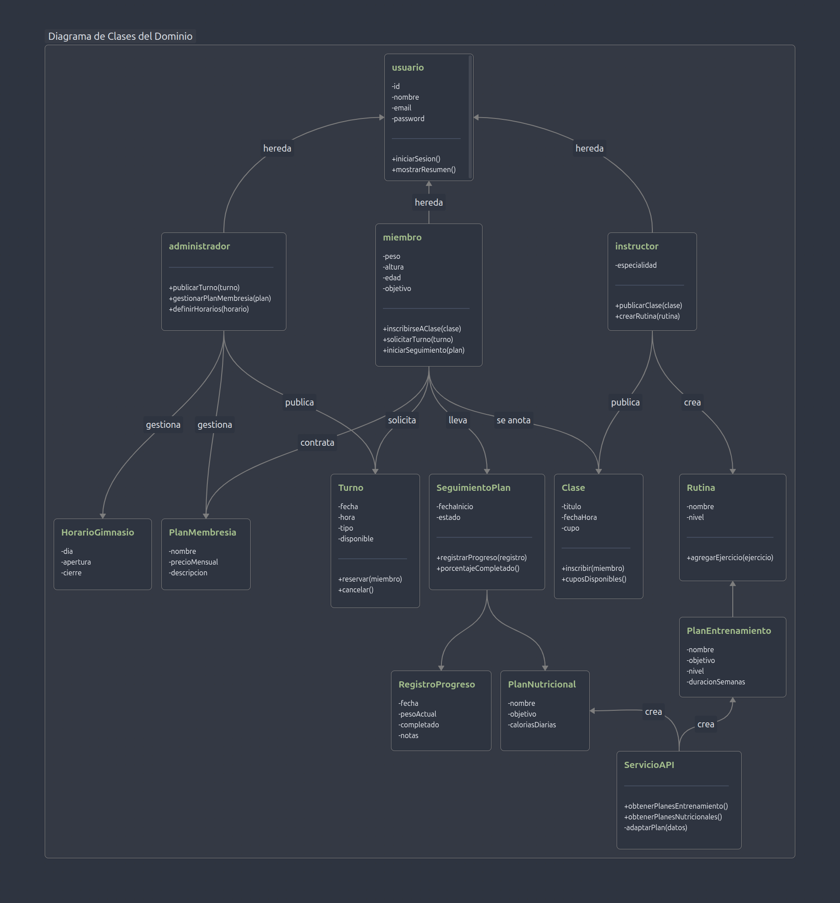
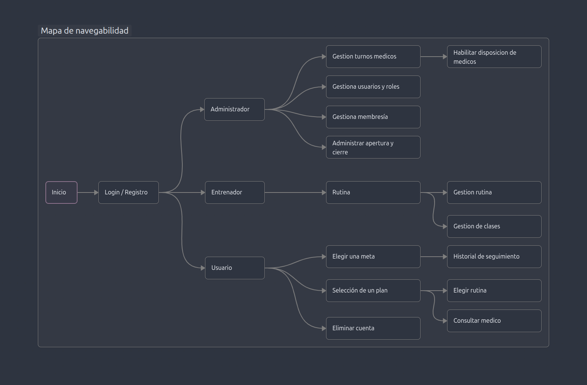

# Arquitectura del Proyecto

Este documento describe la estructura, diseño y los componentes principales del sistema de gestión para el gimnasio Iron Temple.

La aplicación sigue una arquitectura en capas, donde cada una tiene una responsabilidad única y solo se comunica con la capa inmediatamente inferior. Esto garantiza un bajo acoplamiento y una alta cohesión, facilitando las pruebas y el mantenimiento.

---

## Diagrama de Contexto



---

## Diagrama de Clases



---

## Mapa de Navegabilidad



---

## Patrones de Diseño Aplicados

- **Patrón Repositorio:** Abstrae el acceso a los datos. Si mañana se migra de archivos JSON a una base de datos PostgreSQL, solo se cambian los repositorios, sin tocar los servicios.

- **Inyección de Dependencias:** El archivo `src/container.js` es el único lugar donde se instancian los repositorios y servicios. Los servicios reciben sus dependencias por constructor, lo que permite testearlos fácilmente usando mocks.

- **Manejo centralizado de errores:** Los servicios lanzan errores del dominio (ej: `ErrorProhibido`, `ErrorConflicto`) y un middleware global los captura y los traduce a respuestas HTTP estandarizadas (403, 409, etc.).

---

## Diagrama de Capas (Estructura)

La aplicación está dividida internamente en cinco capas bien diferenciadas. El flujo de una petición viaja desde arriba hacia abajo.

```
+---------------------------------------------------------------------------------------+
|                          CAPA DE PRESENTACIÓN (Frontend)                              |
|  [ HTML / CSS ]         [ JS Vanilla (Fetch API) ]        [ Manejo del DOM / Eventos ]|
+---------------------------------------------------------------------------------------+
                                          |
                                          | HTTP Request (JSON)
                                          v
+---------------------------------------------------------------------------------------+
|                             CAPA DE RED (Express)                                     |
|  [ Rutas ]              [ Middlewares (Auth, Permisos) ]        [ Controladores ]     |
+---------------------------------------------------------------------------------------+
                                          |
                                          | Objetos de dominio
                                          v
+---------------------------------------------------------------------------------------+
|                           CAPA DE APLICACIÓN (Servicios)                              |
|  [ Lógica de negocio: Clases, Turnos, Planes de IA, Usuarios, Membresías ]            |
+---------------------------------------------------------------------------------------+
                     |                                            |
                     | Valida con                                 | Persiste en / Consulta
                     v                                            v
+------------------------------------------+     +----------------------------------------+
|         CAPA DE DOMINIO                  |     |       CAPA DE INFRAESTRUCTURA          |
|  [ Modelos: Usuario, Clase, Turno ]      |     |  [ Repositorios (Archivos JSON) ]      |
|  [ Jerarquía de Errores del Dominio ]    |     |  [ Cliente Gemini (IA) ]               |
|                                          |     |  [ Utilidades: Logger, Config ]        |
+------------------------------------------+     +----------------------------------------+
```
