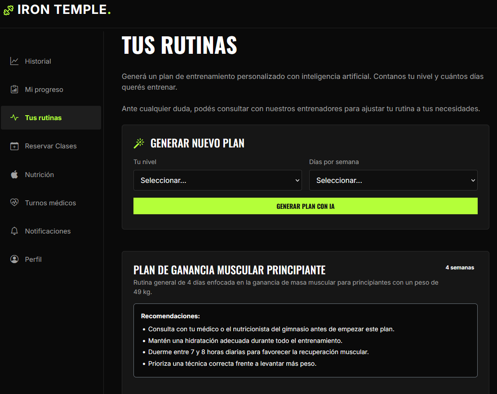

# Guía de uso

**Aplicación:** Iron Temple - Gestión de Gimnasio  
**URL:**  
**Versión:** 1.0.0

## ¿Para quién es?

Esta aplicación está diseñada para tres tipos de usuarios:

- **Miembros:** Personas que asisten al gimnasio y quieren gestionar sus rutinas, turnos médicos, planes nutricionales y ver su progreso.
- **Instructores:** Entrenadores que necesitan crear y administrar sus clases y rutinas.
- **Administradores:** Dueños o personal del gimnasio que gestionan usuarios, membresías, horarios de apertura y turnos disponibles.

## Primeros pasos (ingreso, datos de prueba)

El proyecto no incluye usuarios precargados por defecto para garantizar la privacidad.

**Para crear el primer administrador:**

1. Asegurate de tener el servidor corriendo y el archivo `.env` configurado.
2. Abrí una terminal en la raíz del proyecto y ejecutá:
   ```bash
   npm run crear-admin
   ```

(Este script crea el administrador con los datos que le pases por consola).

3. Una vez creado el admin, podés iniciar sesión con su email y contraseña (el DNI).
4. Desde el panel de administración, andá a la sección "Usuarios" y usá el botón "NUEVO USUARIO / ALUMNO" para crear instructores y miembros de prueba.

## Tareas principales

### Generar un plan de entrenamiento con IA (Miembro)

1. Iniciar sesión como miembro.
2. Ir a **"Tus rutinas"**.
3. En el formulario, seleccionar el nivel de experiencia y los días por semana.
4. Hacer clic en **"GENERAR PLAN CON IA"**.
5. Esperar unos segundos mientras la IA genera el plan. Una vez listo, aparecerá en la pantalla y quedará guardado para futuras sesiones.



### Pedir un turno médico (Miembro)

1. Iniciar sesión con el usuario de prueba de miembro.
2. En el menú lateral, ir a **"Turnos médicos"**.
3. En la sección "Turnos disponibles", buscar el turno que desees (ej: Nutrición).
4. Hacer clic en **"RESERVAR"**.
5. El turno aparecerá en la sección "Mis turnos reservados".

### Crear una actividad (Instructor)

1. Iniciar sesión con el usuario de prueba de instructor.
2. En el menú lateral, ir a **"Mis Actividades"**.
3. En el formulario de "Creación Rápida", completar el Nombre, Fecha y Hora, y el Cupo máximo.
4. Hacer clic en **"CREAR ACTIVIDAD"**.
5. La nueva clase aparecerá en la lista inferior.

### Si algo sale mal: mensajes posibles y qué hacer

- **"No se pudo conectar con Gemini" / "Servicio temporalmente ocupado":** El modelo de IA está saturado. Esperá unos minutos y volvé a intentar, o consultá con un instructor.
- **"Email o contraseña incorrectos":** Verificá que estés usando el DNI como contraseña (sin puntos) o la contraseña que hayas configurado.
- **"La clase ya comenzó" / "Sin cupo":** No se puede reservar una clase pasada o llena. Elegí otra fecha u otra actividad.

## Preguntas frecuentes

**¿Por qué la primera carga es lenta?**
El servidor puede estar en modo "arranque en frío" (cold start) porque el plan gratuito de hosting lo suspende tras un tiempo de inactividad. Esperá unos 30 segundos a que despierte y recargá la página.

**¿La IA guarda mis planes?**
Sí, tus planes de entrenamiento y nutrición son privados y solo vos podés verlos. Se guardan automáticamente.

## Contacto

**Email de soporte:** soporte@irontemple.com
Si experimentás un error, por favor enviá el **código de solicitud** (requestId) que aparece en el mensaje de error para que podamos rastrearlo en los logs del servidor.
